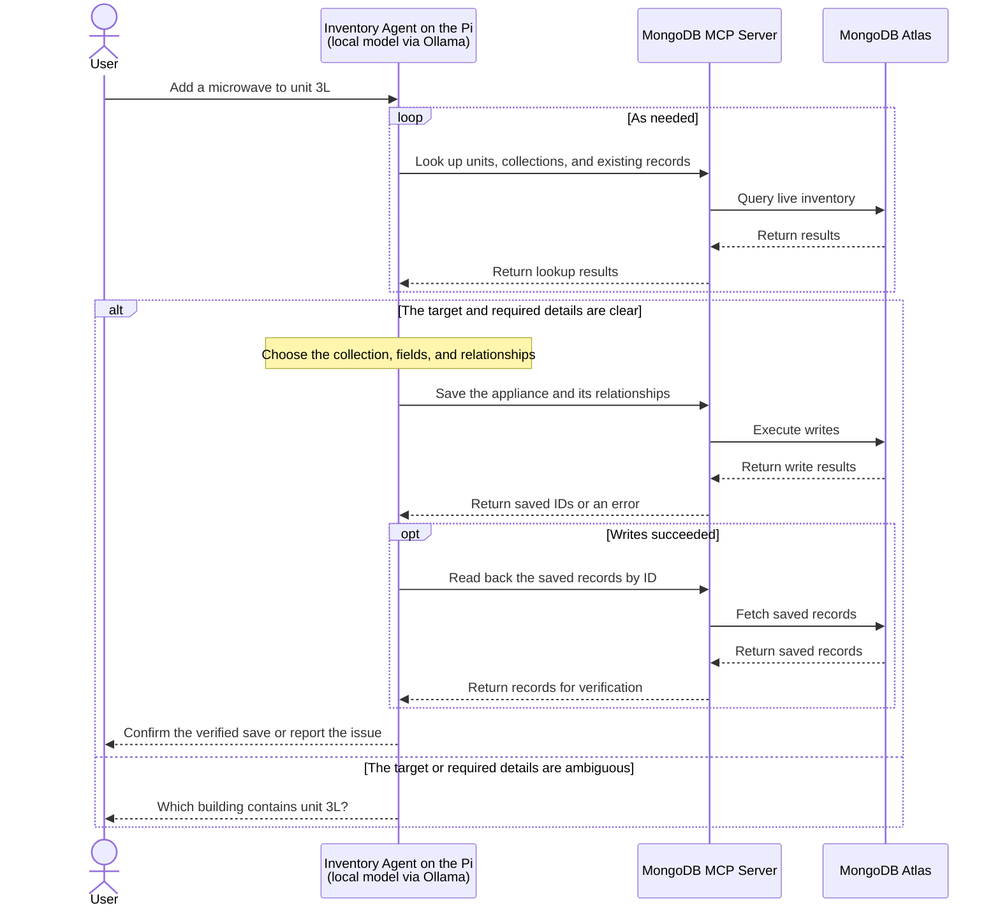

# Property Inventory agent on the Raspberry Pi

Proposed insertion flow. The user calls the inventory agent on the Pi. Ollama runs the local model, and the agent uses MongoDB MCP to look up live inventory, save records, and verify the result.

